<p align="center">
  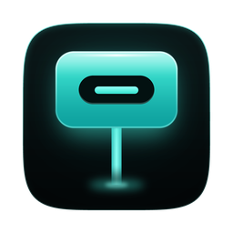
</p>

<h1 align="center">Bus Stop</h1>

<p align="center"><strong>A live map of the ports on your Mac.</strong></p>

Bus Stop is a free, open-source menu bar app for macOS. It shows the physical ports on your Mac, what is plugged into each one, how fast each link runs and how much power flows through it. Hubs, docks and Thunderbolt chains appear as trees, every device is labelled with the port it hangs off, and plain-English diagnostics tell you when a drive is stuck at USB 2 speed or a cable is holding a link back. Everything stays on your Mac: no telemetry, no accounts, and no network connections apart from an update check that you choose to turn on, and the webhooks or MQTT brokers you add yourself.

<p align="center">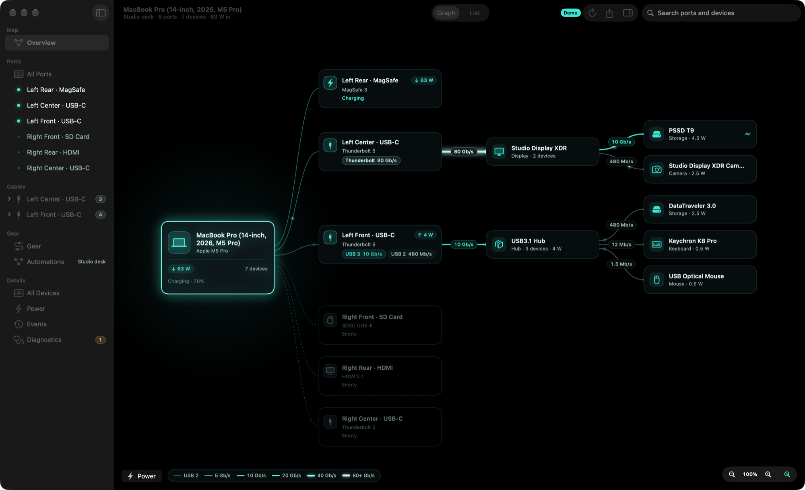</p>

Every screenshot below comes from Bus Stop 1.5.0 in demo mode with the Lagoon colour preset, apart from the collage of all nine presets. Demo mode (Settings › Advanced) shows the same setups on your own Mac, with nothing plugged in. The captions say where to find each feature.

## Features

### The port map in your menu bar

Click the Bus Stop icon in the menu bar for one card per port, in the order the ports sit on the Mac, with what is plugged in, how fast each link runs and how much power flows. Ports carry their real names, such as "Left Front · USB-C" instead of "Port 2". The header names the setup you're at, and the most important diagnostic sits above the ports.

<p align="center">
  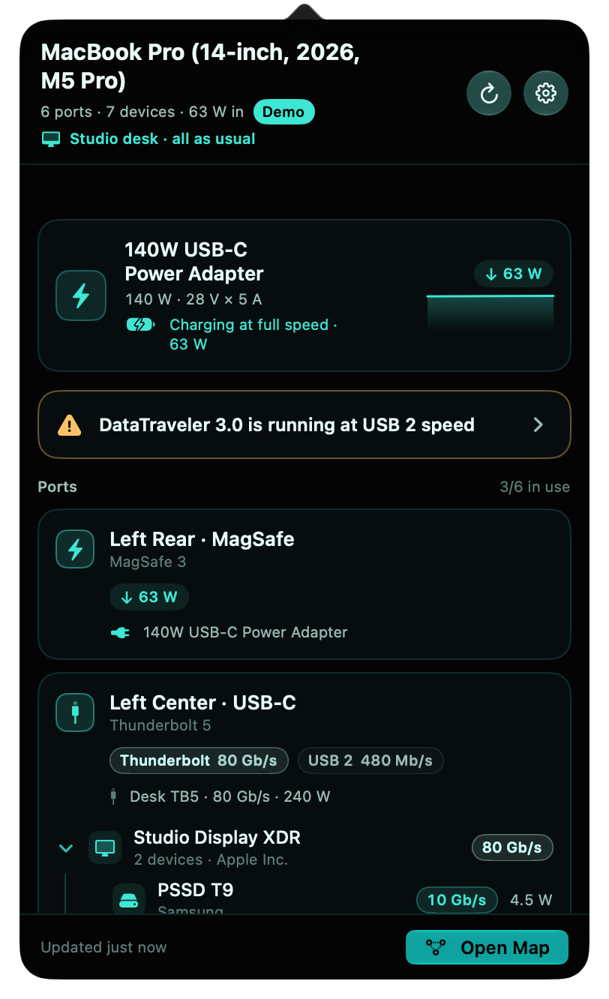
  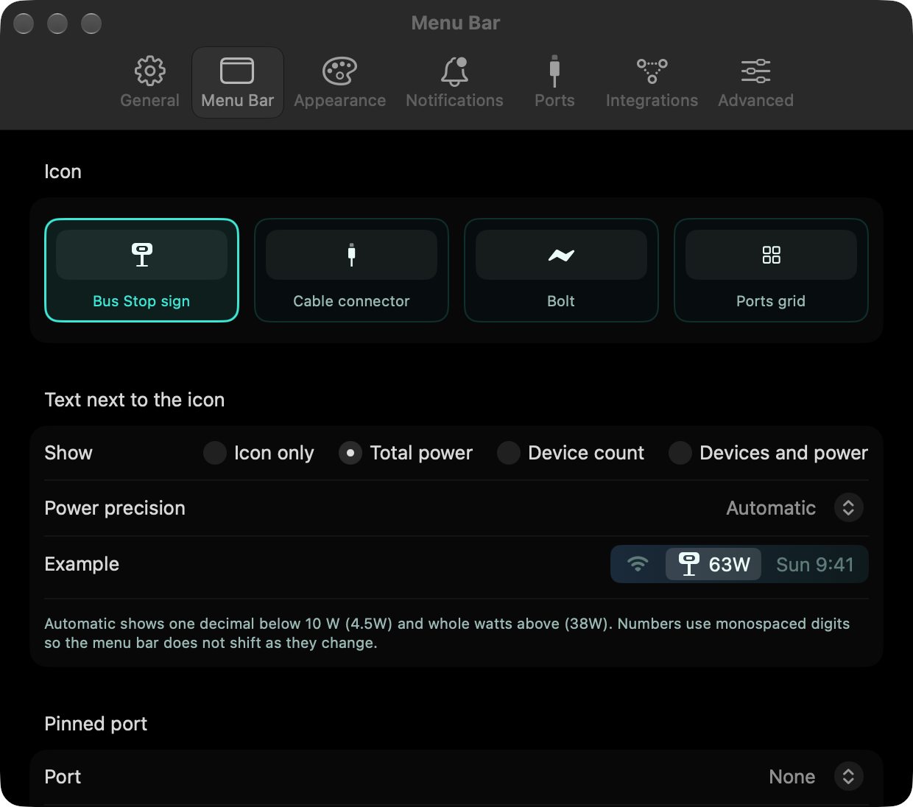
</p>

*Left: the popover, from the menu bar icon. Right: Settings › Menu Bar picks the icon and what shows beside it: total watts, the device count, or one pinned port's speed or watts.*

### A live map of every port, hub, dock and daisy chain

The map window draws the Mac, its ports and every device behind them, with each link coloured by its negotiated speed, such as "USB4 v2 / TB5 @ 80 Gb/s". A Thunderbolt dock shows as one device with what is plugged into it, not as its internal parts. Click any card for an inspector that goes down to the raw IORegistry keys. The map is at the top of this page.

*Open it with Open Map at the bottom of the popover, or right-click the menu bar icon › Open Map. Graph and List switch views at the top of the window.*

### Power, port by port

Turn on Power and every link shows the watts it carries. The Power page splits the charger's input between the Mac and its battery, lists every USB-PD profile the charger offers with the active contract, and charts system and per-port power over the last 10 minutes, hour, day or week.

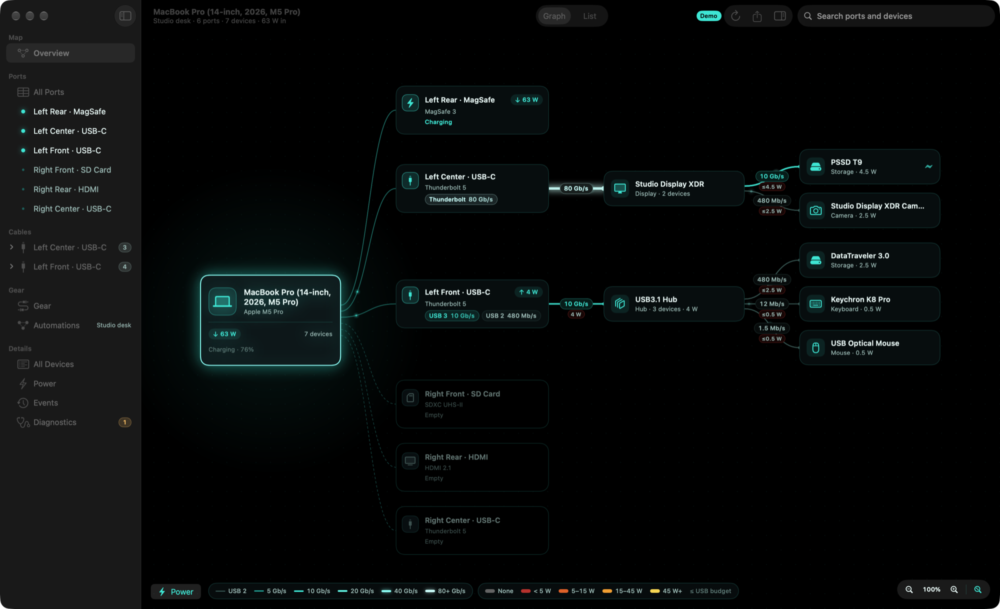

*Turn on Power with the toggle at the bottom left of the map.*

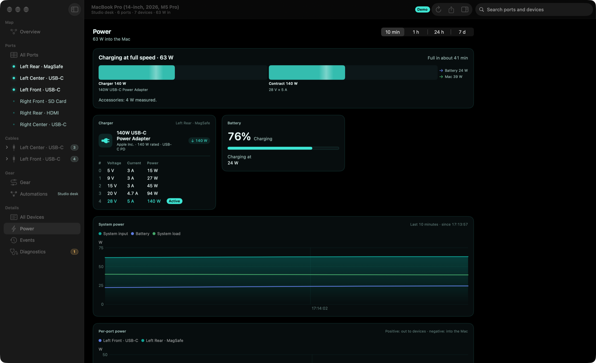

*Open the Power page from the map window's sidebar.*

### A charging coach

When the Mac charges slower than it could, Bus Stop draws the charge path from the charger through the cable, the port and the contract to the battery, marks the narrow part, and names the fix from the gear you already own.

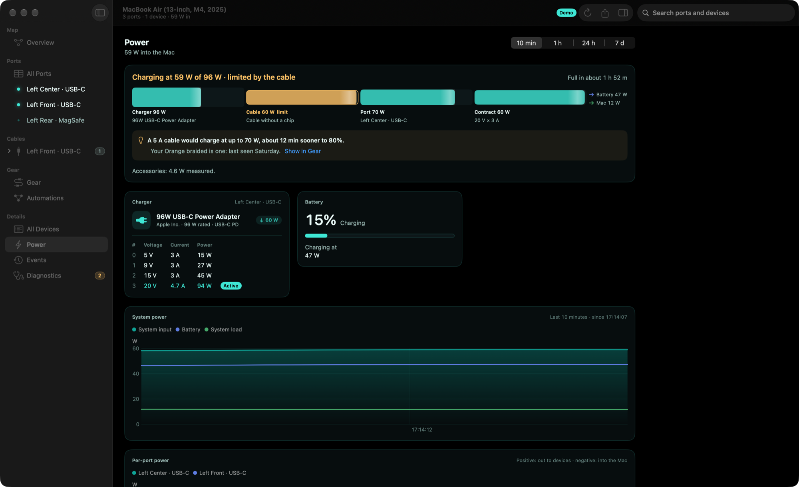

*The top of the Power page, shown here in the Slow cable demo. The popover's charger card gives the same headline, and Settings › Notifications can tell you when charging is held back.*

### Gear: everything you plug in, remembered

Every cable with a chip, charger, device and display you plug in gets a card: what a cable is good for ("Thunderbolt 5, displays and fast charging"), how fast a charger charges this Mac and its 0–80% time, where each thing is plugged in now and when Bus Stop last saw it. Filter by speed or kind, search, name and colour cards, and make a rule from any device.

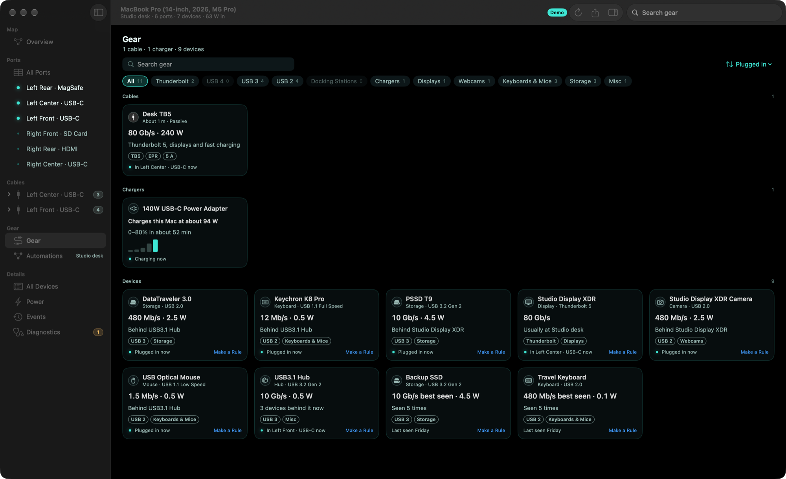

*Open Gear from the map window's sidebar. Settings › Advanced › Gear turns remembering off or forgets everything.*

### Setups and rules

Bus Stop learns the things you plug in together, like your desk with its dock, display and drive, and checks them when you arrive: "PSSD T9 at 5 Gb/s (usually 40 Gb/s). It's on a Plain USB-C cable today." Rules do something when something happens: "When I arrive at Studio desk, run the shortcut Start Work." Rules react to devices, links, charging, battery, diagnostics, setups and new gear, and can notify you, run a shortcut or script, play a sound, speak, write a CSV line or send to an integration. Start from a template, try a rule before you save it, and share rules as files.

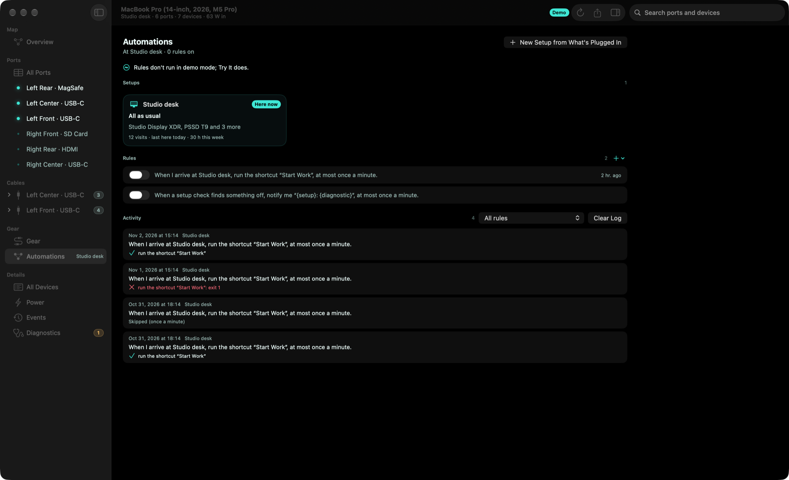

*Open Automations from the map window's sidebar. The + menu beside Rules starts a new rule, from a template or from a shared file. Rules stay off in demo mode, though Try It still runs them.*

### Diagnostics in plain English

Bus Stop explains what is wrong and what would fix it: a USB 3 device running at USB 2 speed, a link slowed by its cable, a charger too weak for the Mac, a hub over its power budget, liquid in a port, a device that keeps disconnecting, or a port with far more errors than its siblings.

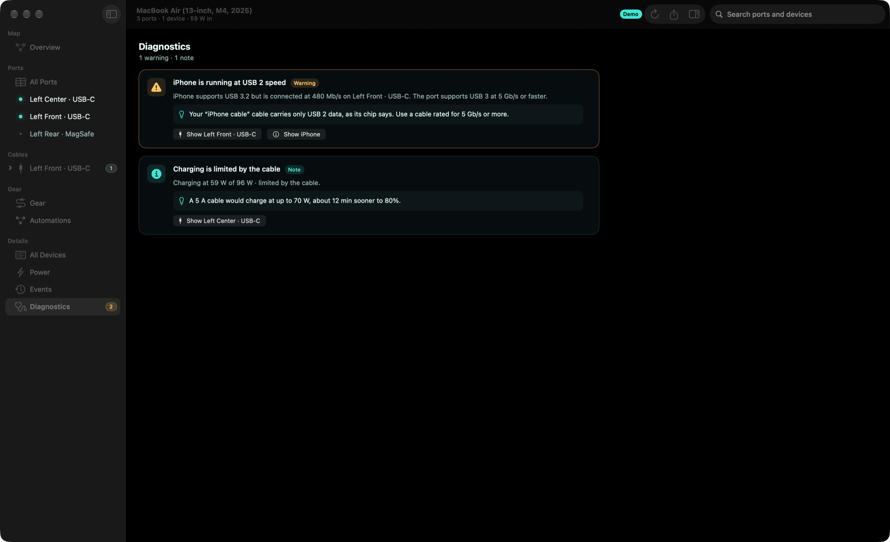

*Open Diagnostics from the map window's sidebar; this shot uses the Slow cable demo. The popover shows the most important finding.*

### Every change, as it happens

Plugs, unplugs and speed changes show up at once in an event log that Bus Stop keeps between launches, and can raise a notification.

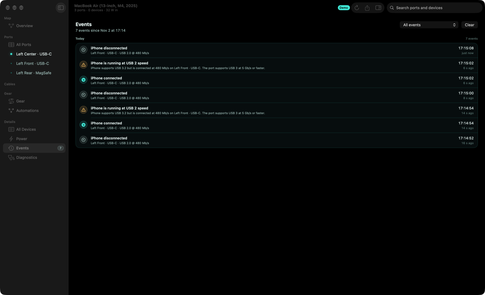

*Open Events from the map window's sidebar; this shot uses the Flaky cable demo.*

<p align="center">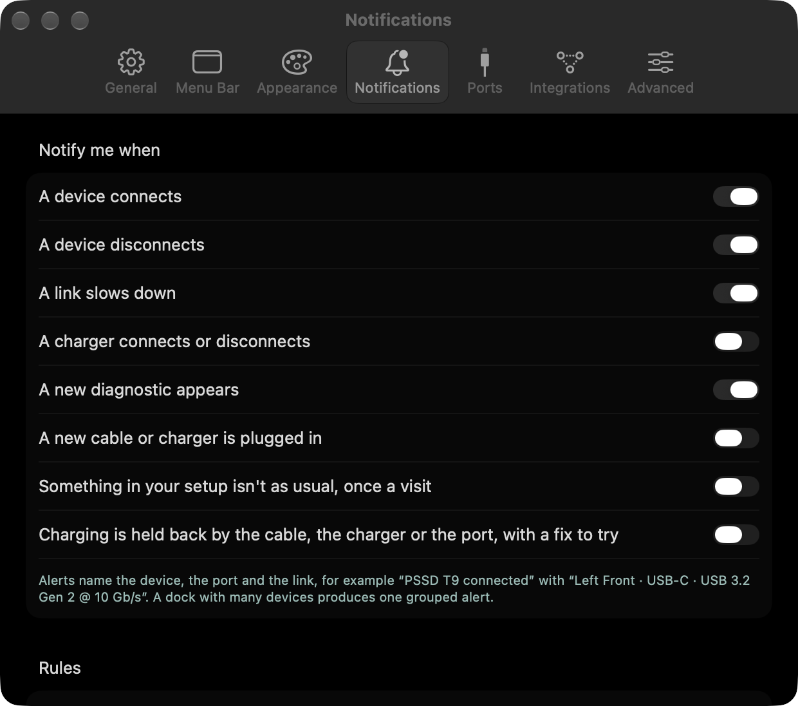</p>

*Settings › Notifications chooses which changes alert you.*

### Home automation

Send events and live values to Home Assistant, Node-RED or anything that takes a webhook or MQTT. With Home Assistant discovery, Bus Stop appears as a ready-made device with sensors and triggers, no YAML. Nothing is sent until you add a destination. See [Home Assistant](docs/home-assistant.md).

<p align="center">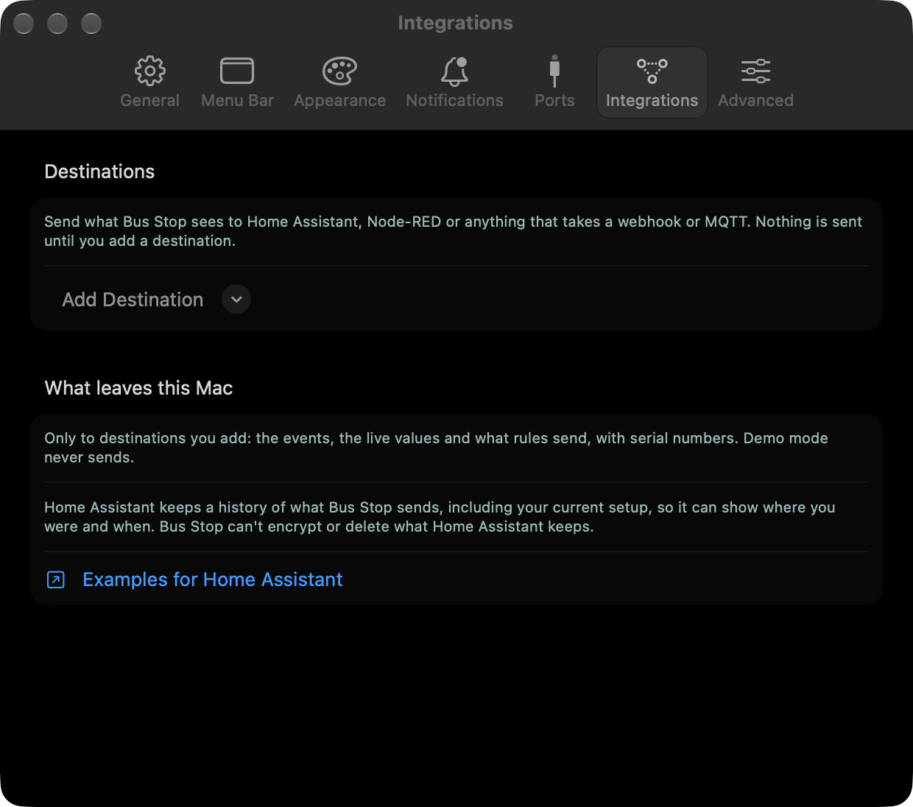</p>

*Add a webhook or MQTT broker with Add Destination in Settings › Integrations.*

### Port names you can trust

Bus Stop names each port from the Mac itself or from a per-model catalogue. Rename any port, or plug something into it and let Identify a Port find it for you.

<p align="center">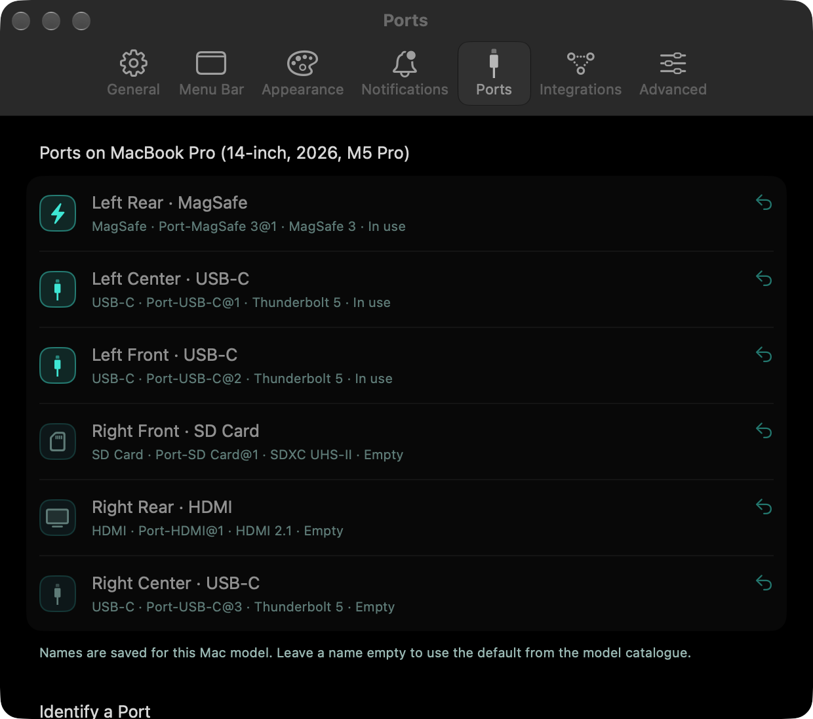</p>

*Rename ports in Settings › Ports. Identify a Port is at the bottom of the pane.*

### Shortcuts, Siri, Spotlight and widgets

Ask "Why is my Mac charging slowly in Bus Stop?", build shortcuts from what's plugged in, add Bus Stop's controls to Control Center, and find your gear in Spotlight with Settings › General › Show in Spotlight. Desktop widgets show Ports, Power and Health in Large and Extra Large, and a Port widget follows one port. See [Shortcuts, Siri and Spotlight](docs/shortcuts.md).

To find the actions, search for "Bus Stop" in the Shortcuts app. To add the widgets, right-click the desktop and choose Edit Widgets.

### Make it yours

Choose Dark, Light or Match System, and one of nine colour presets that colour the whole interface and the widgets.

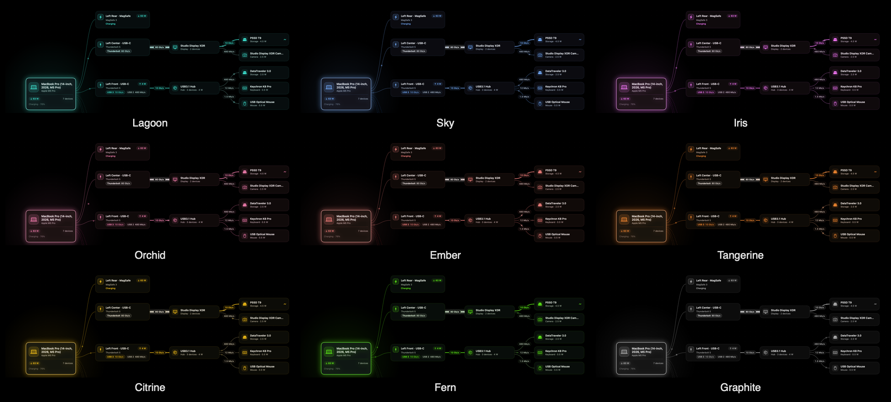

<p align="center">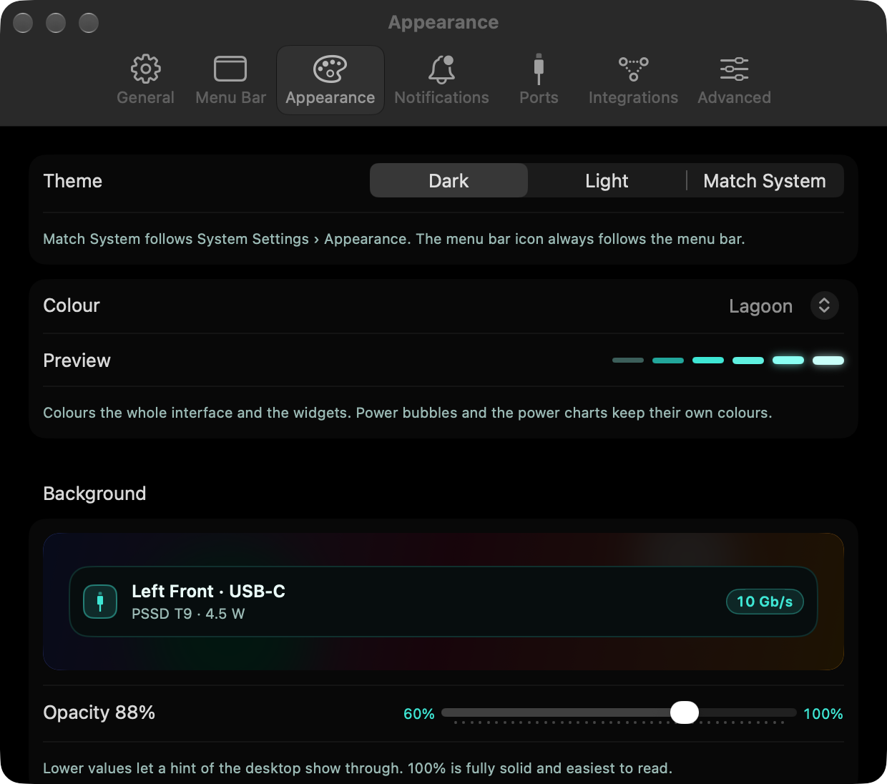</p>

*Pick a theme and a colour preset in Settings › Appearance.*

### Export

Save a JSON snapshot, a Markdown report or a raw capture for bug reports, with serial numbers redacted. Use the Export button in the map window's toolbar, right-click the menu bar icon › Export, or Settings › Advanced › Export.

## Requirements

- macOS 26 Tahoe or later. Bus Stop is designed for macOS 27.
- Apple silicon recommended. On an Intel Mac with macOS 26 the port controllers do not publish per-port detail, so the map is less complete.

## Install

Download [`BusStop.dmg`](https://github.com/static74/BusStop/releases/latest/download/BusStop.dmg) from the [latest release](https://github.com/static74/BusStop/releases/latest), open it and drag **Bus Stop** onto the Applications folder beside it. Releases are signed with a Developer ID and notarized by Apple. Keep it in `/Applications`: the desktop widgets appear in Edit Widgets only from there.

To check the download, put `BusStop.dmg.sha256` from the release next to the image and run `shasum -a 256 -c BusStop.dmg.sha256`.

Bus Stop lives in the menu bar: left-click the icon for the port map, right-click it for the menu. While one of its windows is open it also shows a Dock icon, which you can turn off in Settings › General.

### Homebrew

```bash
brew install --cask static74/busstop/busstop
```

This installs Bus Stop from the project's tap, [static74/homebrew-busstop](https://github.com/static74/homebrew-busstop), and links the `busstop` command into Homebrew's `bin`. Because Bus Stop can update itself, the cask is marked `auto_updates`, so `brew upgrade` skips it; if you keep automatic updates off, update with `brew upgrade --cask --greedy busstop`.

### Updates

The first time Bus Stop opens, it asks whether to install updates automatically; they start off. With them on, it checks GitHub once a day, verifies a new release's SHA-256, developer signature and notarization, installs it while no Bus Stop window is open and relaunches. Settings › General turns this on or off and has Check for Updates, which never installs anything until you click Install and Relaunch.

<p align="center">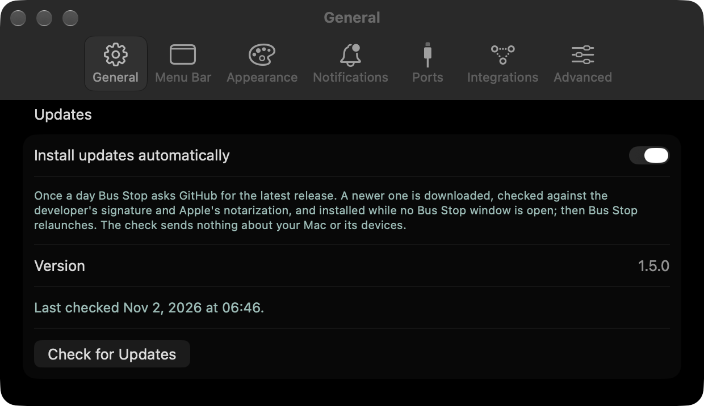</p>

*Turn updates on or off, or check now, in Settings › General › Updates.*

## Command-line tool

The app bundle contains `busstop` at `Bus Stop.app/Contents/Helpers/busstop`; the Homebrew cask links it into Homebrew's `bin`.

```
busstop                         # human-readable tree
busstop --json                  # the snapshot as JSON
busstop --markdown              # a Markdown report
busstop --raw > capture.json    # raw IORegistry capture, for bug reports
busstop --watch                 # print connection changes as they happen
busstop --watch --rules         # run your rules, even with no one at the screen
busstop --gear                  # the cables, chargers, devices and setups Bus Stop remembers
busstop --demo studioDesk       # any of the above against a demo setup
busstop --input capture.json    # read a capture saved with --raw instead of this Mac
```

Serial numbers are redacted from every output unless you add `--no-redact`. `busstop --help` lists every option, including sending to a webhook or MQTT broker, and the demo setups (`studioDesk`, `travel`, `dockStation`, `unplugged`, `flakyCable`, `slowCable`).

`busstop --demo studioDesk` prints:

```
MacBook Pro (14-inch, 2026, M5 Pro) · macOS 27.0 · demo · at Studio desk · all as usual
Power: Charging at full speed · 62 W · 76% · 140W USB-C Power Adapter · 28 V × 5 A · Full in about 41 min · 4 W to ports
├─ Left Rear · MagSafe   140W USB-C Power Adapter   ↓ 62 W
├─ Left Center · USB-C   USB4 v2 / TB5 @ 80 Gb/s
│  └─ Studio Display XDR · 80 Gb/s
│     ├─ PSSD T9 · 10 Gb/s · 4.5 W
│     └─ Studio Display XDR Camera · 480 Mb/s · 2.5 W
├─ Left Front · USB-C   USB 3.2 Gen 2 @ 10 Gb/s   ↑ 4 W
│  └─ USB3.1 Hub · 10 Gb/s · 4 W
│     ├─ DataTraveler 3.0 · 480 Mb/s · 2.5 W
│     ├─ Keychron K8 Pro · 12 Mb/s · 0.5 W
│     └─ USB Optical Mouse · 1.5 Mb/s · 0.5 W
├─ Right Front · SD Card   (empty)
├─ Right Rear · HDMI   (empty)
└─ Right Center · USB-C   (empty)

Displays
├─ Color LCD · 3024 × 1964 @ 120 Hz · built-in
└─ Studio Display XDR · 5120 × 2880 @ 120 Hz · Left Center · USB-C

Diagnostics
└─ Warning: DataTraveler 3.0 is running at USB 2 speed
```

## Privacy

- No analytics, no crash reporting, no accounts.
- The only network connection Bus Stop makes on its own is the update check, and only when automatic updates are on or you click Check for Updates. It asks GitHub for the latest release and downloads it from there, sending Bus Stop's version and nothing about your Mac or its devices; like any web request, it shows GitHub your IP address.
- Integrations send only where you point them, once you add a webhook or MQTT broker in Settings › Integrations. They send what Bus Stop sees, with device names and serial numbers as the devices give them. Demo mode never sends. Home Assistant keeps a history of what it receives; Bus Stop can't delete it.
- Bus Stop only reads IORegistry properties, the power-source API, the display list, the SMC's read-only power keys, and the Mac's model, chip and macOS version. It never ejects, powers off or reconfigures anything, and it reads the computer name only to name this Mac to an integration you add.
- Settings and port names are stored in the app's preferences. The history, Gear, setups, rules and integrations are encrypted (AES-256-GCM) in `~/Library/Application Support/io.github.static74.busstop/`, with the key in your login keychain, and the widgets read an encrypted copy of what they show from a folder the app shares only with them. The history and widget data hold device names and serial numbers, which redacted exports hide; Gear and setups hold none, and know chargers and devices by codes that can't be turned back into them. The history never holds the Mac's own serial number. Settings › Advanced clears the history and Gear or turns them off.
- Encryption protects copies of those files in backups, synced folders and bug reports. It doesn't protect against someone signed in as you, and it doesn't cover what you export. Copies built from source keep their key in a file beside their data instead.
- Nothing else is written unless you ask: an export, a rule that writes a CSV file or runs a script (Settings › Advanced › Allow rules to run scripts), or Settings › General › Show in Spotlight, which adds your devices, cables, chargers and setups to the Spotlight index.

<p align="center">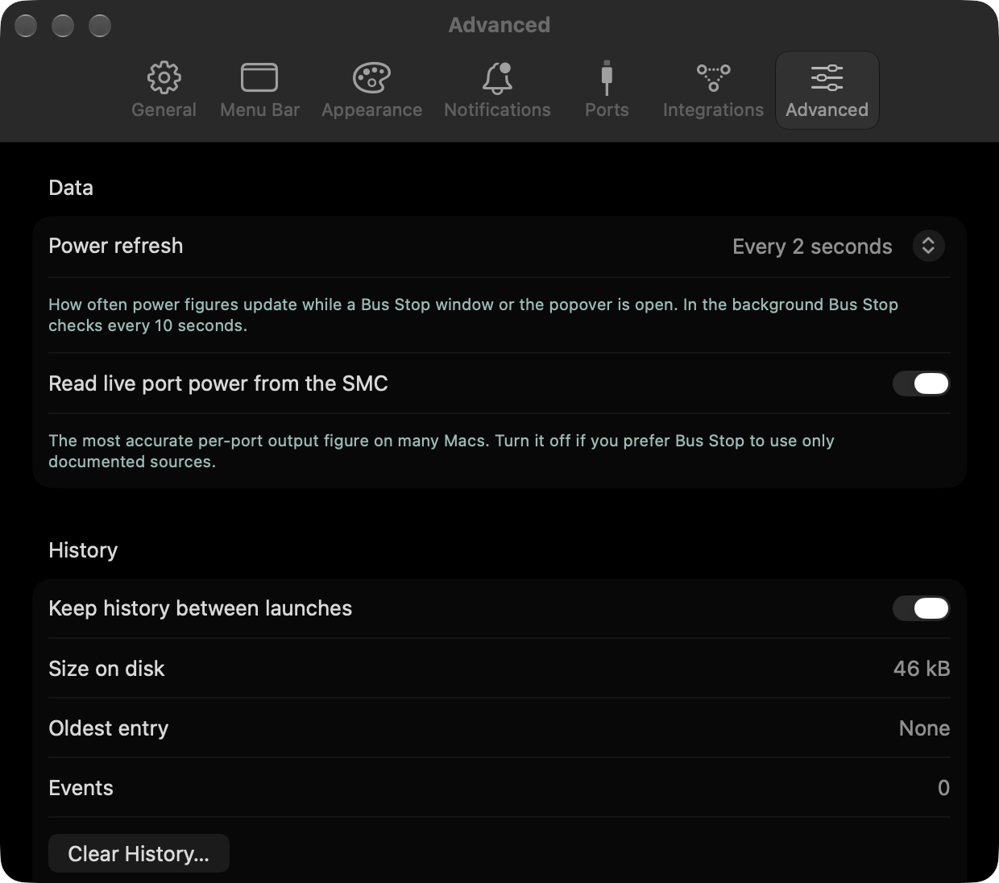</p>

*Settings › Advanced › History shows what Bus Stop keeps, clears it, or turns saving off.*

## How it works

macOS already knows which controller drives each port, what is plugged in, the speed each link negotiated and the power flowing through it. Bus Stop reads that information and turns it into a map of ports and the devices behind them. It only ever reads; it never changes anything.

## Bug reports

Bug reports with a raw capture (`busstop --raw > capture.json`) are the most useful thing you can send; the [bug report form](https://github.com/static74/BusStop/issues/new?template=bug_report.yml) asks for everything we need.

## Credits

- **[PortScope](https://github.com/azenla/portscope)** by Alex Zenla (MIT): the per-model catalogue of physical port locations.
- **[The USB ID Repository](http://www.linux-usb.org/usb-ids.html)** (3-clause BSD License): the names of USB vendors, for devices that do not report their own. The list is built into the app; Bus Stop never downloads it.
- **[WhatPort](https://github.com/darrylmorley/whatport)** and **[WhatCable](https://github.com/darrylmorley/whatcable)** by Darryl Morley (MIT): research on Apple's port controllers, SMC power channels and Thunderbolt chain attribution.
- The Linux kernel's Thunderbolt driver ([`drivers/thunderbolt/tb_regs.h`](https://github.com/torvalds/linux/blob/master/drivers/thunderbolt/tb_regs.h)) documents the link speed codes Bus Stop decodes. No kernel code is used.

Full licence texts are in [THIRD_PARTY_NOTICES.md](THIRD_PARTY_NOTICES.md), which every build also carries in `Bus Stop.app/Contents/Resources`.

## Licence

Bus Stop is released under the [MIT License](LICENSE).

Apple, Mac, macOS, MagSafe and Xcode are trademarks of Apple Inc. Thunderbolt is a trademark of Intel Corporation. USB-C and USB4 are trademarks of the USB Implementers Forum. HDMI is a trademark of HDMI Licensing Administrator, Inc. Bus Stop is not affiliated with or endorsed by any of them.
